# NCRTC Bus Management System

Student/capstone MVP for the NCRTC RRTS **feeder-bus** network: live fleet view (AVLS), weekly duties (Scheduling), incident triage (IMS), and driver notices (CMS).

> **Assumption (be honest in demos):** Live GPS is **simulated**. The `gps_tick` service inserts pings every few seconds; the map polls `/api/avls/live` every 5s. Seeded dummy depots/vehicles/users/routes power the demo — not hardware GPS or production ingest.

## Features

| Module | What you can do |
| --- | --- |
| **AVLS** | Live map (5s refresh) with motion-coloured markers, depot polygons, searchable fleet list, 30-min trails; **PostGIS geofence breach alerts**; **trip replay** with scrubber, 1×/5×/20× playback and trip stats |
| **Scheduling** | Weekly roster grid with week navigation, **copy last week**, click-to-assign, per-duty or whole-week publishing, driver conflict checks; route builder |
| **IMS** | Raise incidents with photos, panic button (P1 with last GPS position), **SLA timers** with breach filter, valid-only status transitions, audit timeline, link to the vehicle's path that day |
| **CMS** | Targeted notices (everyone / drivers / role / depot), inbox with unread filter, explicit acknowledgement, **who hasn't read it** receipts |
| **Admin** | Register vehicles and change status, create/deactivate accounts with role and depot |
| **Driver app** | Phone-first `/driver` PWA: today's duty, stops, acknowledge, notices, sticky panic bar with confirmation |

## Stack

| Layer | Choice |
| --- | --- |
| Frontend | React + Vite + TypeScript + Tailwind + Leaflet/OSM |
| Backend | Python FastAPI + SQLAlchemy + Alembic |
| DB | PostgreSQL 16 + PostGIS |
| Auth | JWT + bcrypt |
| Driver app | Responsive PWA route at `/driver` |
| Runtime | Docker Compose |

## Quick start

```bash
git clone <this-repo>
cd ncrtc-bus-management-system   # or /agent/ncrtc-bms on the Cloud VM
cp .env.example .env
docker compose up --build
```

Open:

| URL | What |
| --- | --- |
| http://localhost:5173 | Web app (admin / control room / manager) |
| http://localhost:5173/driver | Driver PWA (after login as driver) |
| http://localhost:8000/docs | OpenAPI docs |
| http://localhost:8000/health | Health (`gps: simulated`) |

Seed runs automatically on first backend start when the DB is empty (`SEED_ON_STARTUP=true`).

### Host networking note (some Linux VMs)

If the backend stays on “Waiting for database…” while `db` is healthy, bridge netfilter may block container↔container traffic:

```bash
sudo sysctl -w net.bridge.bridge-nf-call-iptables=0
docker compose restart backend gps_tick
```

## Environment variables

Copy from [`.env.example`](./.env.example). **Never commit `.env` or real secrets.**

| Variable | Purpose | Default (demo) |
| --- | --- | --- |
| `POSTGRES_USER` / `POSTGRES_PASSWORD` / `POSTGRES_DB` | DB credentials | `ncrtc` / `ncrtc_demo_password` / `ncrtc_bms` |
| `DATABASE_URL` | SQLAlchemy URL | `postgresql+psycopg://…@db:5432/ncrtc_bms` |
| `JWT_SECRET` | JWT signing key | change in real deploys |
| `JWT_ALGORITHM` | JWT alg | `HS256` |
| `ACCESS_TOKEN_EXPIRE_MINUTES` | Session length | `480` |
| `CORS_ORIGINS` | Allowed browser origins | `http://localhost:5173,…` |
| `VITE_API_URL` | Frontend → API base (build-time) | `http://localhost:8000` |
| `SEED_ON_STARTUP` | Auto-seed empty DB | `true` |
| `GPS_TICK_INTERVAL_SECONDS` | Simulated ping interval | `7` |

## Demo credentials (DEMO ONLY)

All seeded users share password: **`password`**

| Username | Role | Typical demo use |
| --- | --- | --- |
| `admin` | admin | Create routes, publish notices, full access |
| `manager1` | depot_manager | Noida Sec-37 roster + depot incidents |
| `manager2`…`manager5` | depot_manager | Other depots |
| `control1` / `control2` | control_room_operator | Live map + triage |
| `driver1`… | driver | Driver PWA |
| `conductor1`… | conductor | Driver PWA |

Seed size: **5 depots**, **~50 vehicles**, **~80 users**, **12 routes**, one week of duties, yesterday GPS history, sample incidents & notices.

## How to test

```bash
# With stack running (20 API tests against the seeded Postgres/PostGIS stack):
docker compose exec backend pytest -q

# Frontend unit tests (12 tests: dates, API client, geo maths, SLA rules, app shell):
cd frontend && npm install && npm test
```

## Demo flow (PRD)

1. `docker compose up --build` — seed runs.  
2. Login `admin` → Scheduling → create a route (pick stops) → Notices → **New notice** → publish.  
3. Login `manager1` → roster → **Copy last week** on next week → **Publish week** (or Publish on a draft cell).  
4. Login `driver1` (narrow window) → `/driver` → acknowledge duty → open notice → acknowledge → **Panic** → confirm.  
5. Login `control1` → Live Map (markers move, geofence banner) → pick a bus → **Replay today** → Incidents → SLA chip on the P1 → acknowledge / assign.  
6. Back as `admin` → Notices → open the notice → read receipts show who hasn't read it yet.  
7. Fleet & Users → put a bus into maintenance, create a driver account.  
8. http://localhost:8000/docs  

## Documents

[Additional assumptions and decisions (PDF)](docs/NCRTC_BMS_Assumptions_and_Decisions.pdf) — what this build assumes, what was chosen, and what from the brief is not built. Written for a team-leader review. It matches the repository as of 23 October 2026.

## Repo layout

```
backend/     FastAPI, Alembic, seed, gps_tick, tests
frontend/    React admin shell + /driver PWA
docker-compose.yml
ARCHITECTURE.md
docs/NCRTC_BMS_Assumptions_and_Decisions.pdf
media/ncrtc-bms/   screenshots
```

## Screenshots

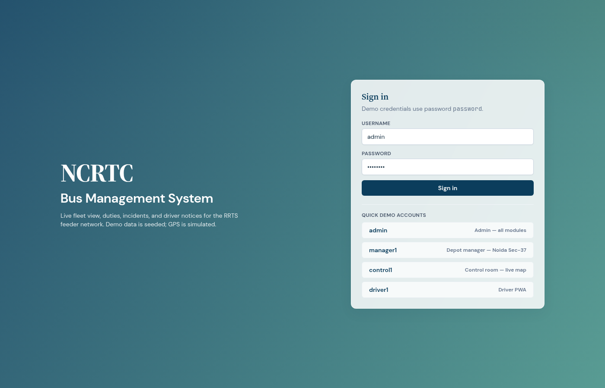

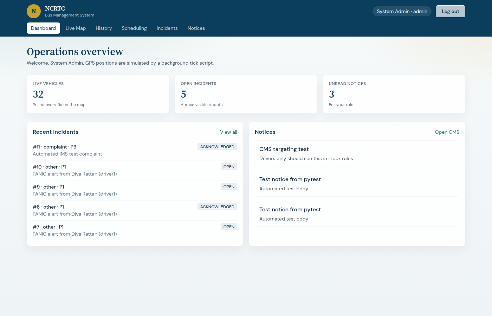

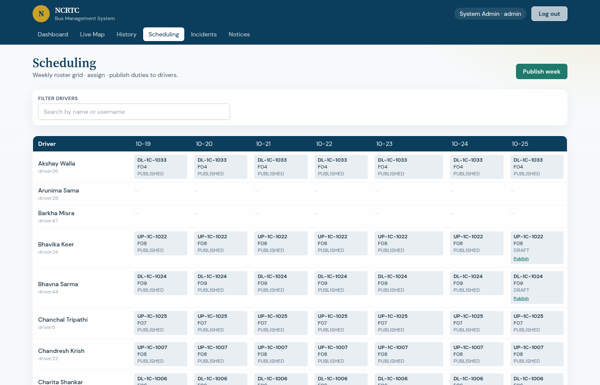

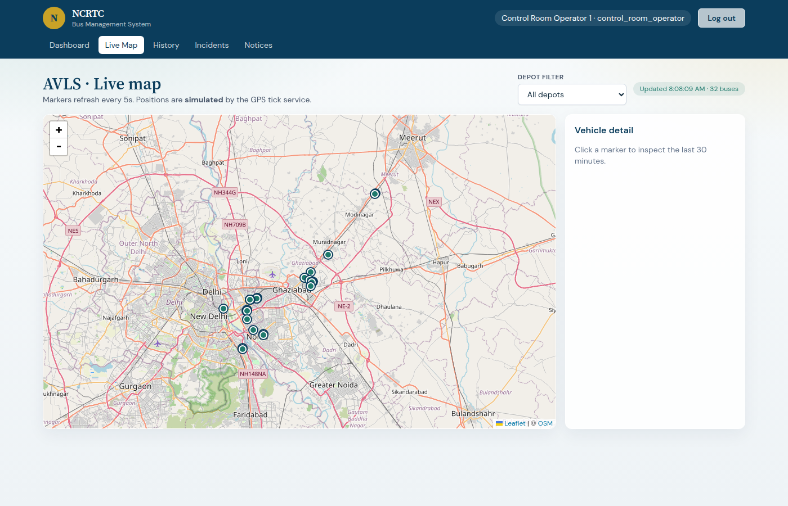

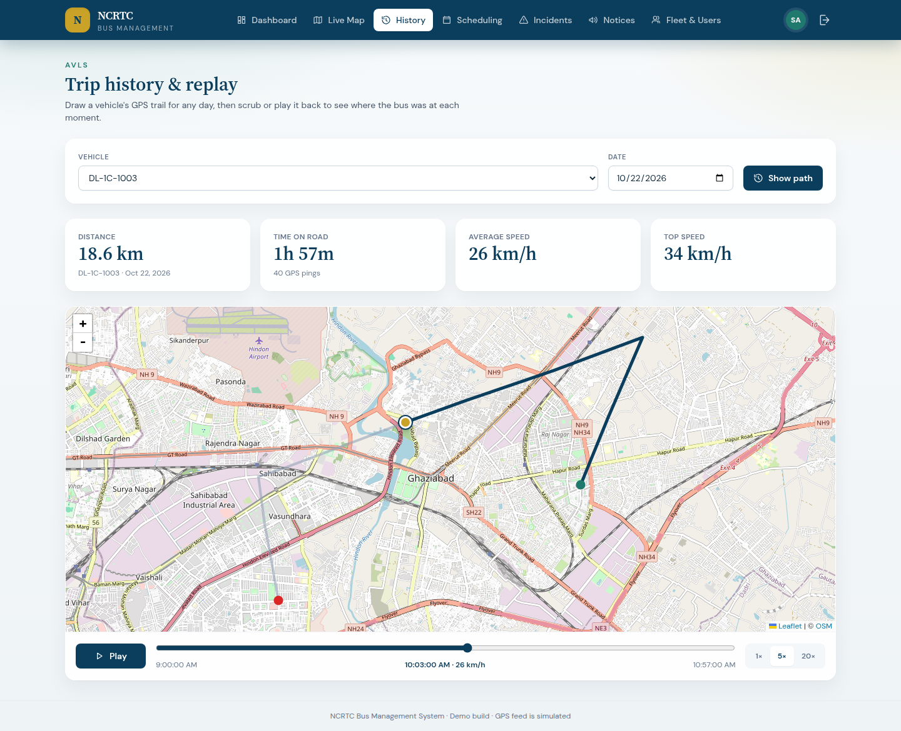

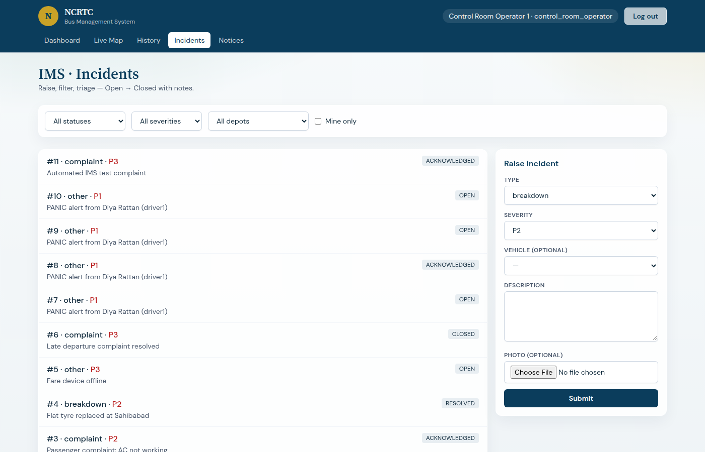

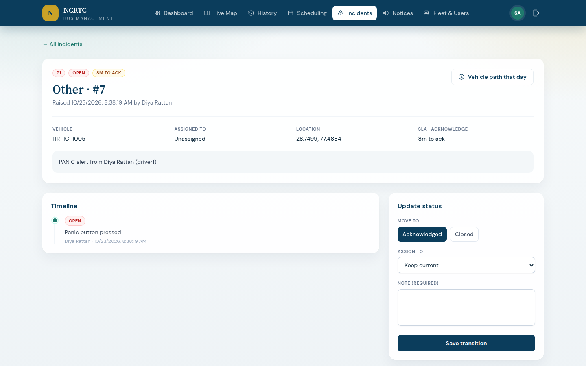

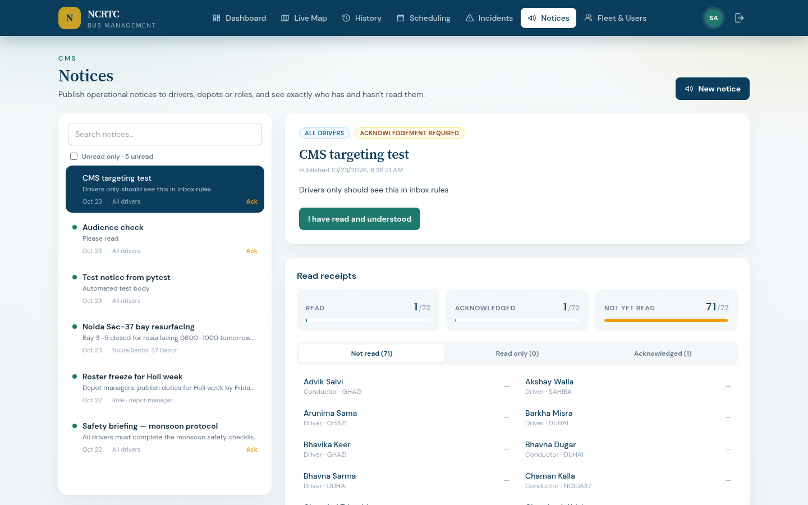

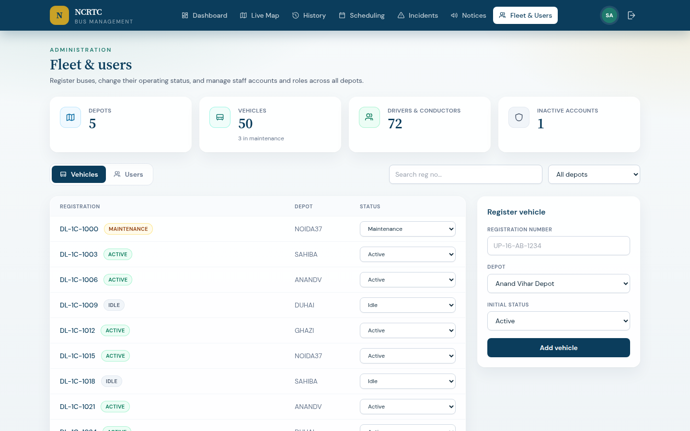

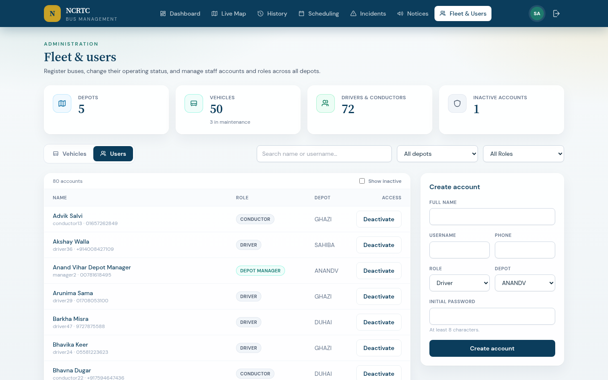

<p>
  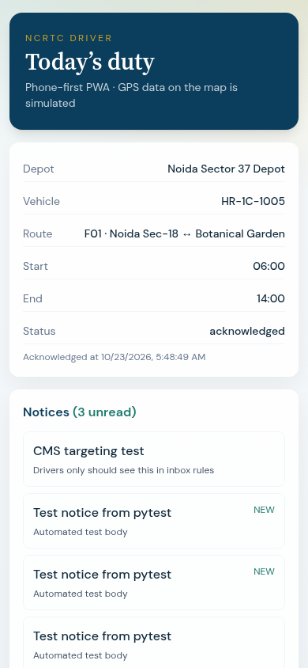
  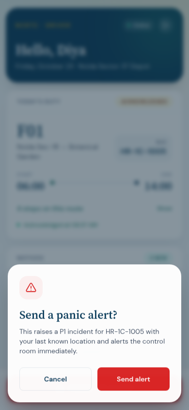
</p>

## Limitations (known)

- GPS is simulated (tick script), not device ingest / WebSocket.  
- SLA targets are applied in the UI; there is no server-side escalation or notification on breach.  
- Geofence alerts are a live query, not stored/acknowledged events.  
- Incident photos stored on a local Docker volume (`uploads/`), not object storage.  
- Executive read-only role from the PRD narrative is not a sixth role; use admin/control for reports.

## License

Academic / demo use. NCRTC branding for project context only.
